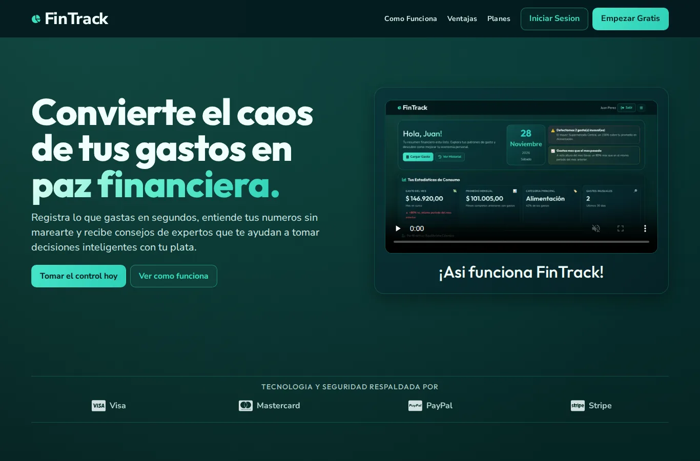
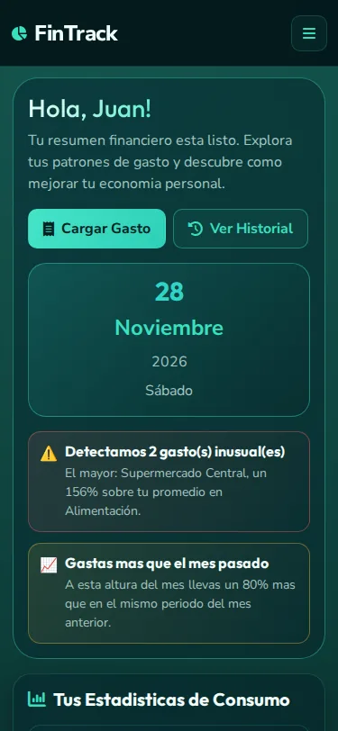
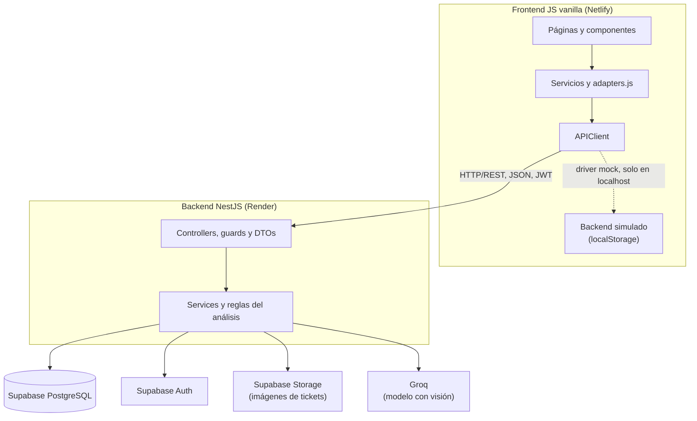
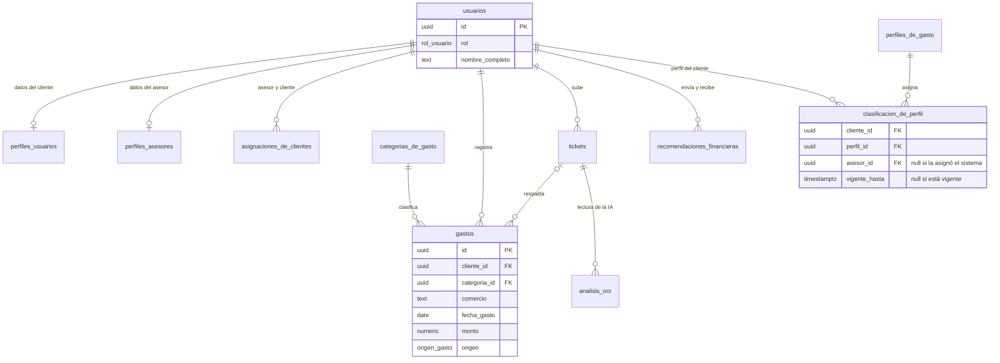

# FinTrack 2026

Plataforma web de gestión de gastos personales con carga de tickets por OCR/IA, para la materia **Ingeniería Web II (2026)**. Grupo: Daniel Olguín y Celeste Núñez.

- **Online:** front https://fintrack-iua.netlify.app · API https://fintrack-api-5vmm.onrender.com/api/v1
- **Consigna:** [docs/consigna.pdf](docs/consigna.pdf)
- **Video de demo** (1:20, sin audio): en la landing, o directo en [`frontend/assets/video/demo-fintrack.mp4`](frontend/assets/video/demo-fintrack.mp4).
- **Detalle técnico:** [backend/README.md](backend/README.md) (contrato de la API, reglas, base de datos, tests) y [frontend/README.md](frontend/README.md) (estructura, componentes, estilos).

---

## 1. Descripción y roles

FinTrack permite a una persona registrar sus gastos, a mano o subiendo la foto de un ticket que una IA interpreta, y entender en qué gasta. Un asesor financiero analiza los patrones de consumo de sus clientes y les envía recomendaciones.

- **Usuario** es cualquier cuenta. El rol que carga gastos se llama siempre **cliente**.
- **Asesor**: atiende a los clientes que tiene asignados. Al registrarse, cada cliente queda asignado al asesor activo con lugar libre que tenga menos clientes.

> Las capturas son del backend simulado, con datos ficticios.



## 2. Funcionalidades

**Cliente**
- Registro e inicio de sesión; perfil de cuenta (ocupación, ingreso estimado, objetivo financiero, tema claro/oscuro).
- **Carga de gastos**: formulario manual o **foto del ticket**, que la IA lee y precompleta para revisar antes de guardar.
- **Historial**: búsqueda, filtros por categoría y origen, orden, detalle, edición, recategorización y borrado.
- **Dashboard**: gasto del mes y variación, promedio mensual, categoría principal, alertas, gastos inusuales, gráficos (por día, **torta por categoría**, **barras por mes** con promedio) y **ranking de comercios**.
- **Patrones de consumo**: evolución total y por categoría, día de mayor gasto y gastos inusuales.
- **Perfil de gasto**: el vigente y si lo asignó el asesor (el cliente no lo elige).
- **Recomendaciones** del asesor: filtros y "marcar como leída".




**Asesor**
- Dashboard de la cartera: clientes activos, clientes con alertas, recomendaciones leídas, gráficos por perfil y actividad mensual.
- **Mis clientes**: búsqueda y filtros por riesgo y estado, en tarjetas o tabla.
- **Análisis por cliente**: perfil de gasto (sugerido o asignado por el asesor, con motivo), nivel de riesgo, indicadores, gráficos, gastos inusuales, ranking de comercios, últimos gastos y recomendaciones enviadas.
- **Generar recomendaciones** (título, tipo, prioridad y mensaje) y perfil profesional (especialidad, matrícula, descripción).


**Extras opcionales de la consigna:** categoría sugerida por la IA (1), dashboard con varios gráficos (2), alertas de gasto inusual y de aumento mensual (3, sin límites de presupuesto), comparación con el mes anterior (6), patrones de consumo (7), ranking de comercios (8), búsqueda y filtros (9, sin rango de fechas ni montos en la UI), modo oscuro (11), edición de los datos detectados en el ticket (13) y perfil financiero del usuario (16).

## 3. Arquitectura



- **Frontend** (`frontend/`): ES modules nativos, sin bundler ni frameworks de componentes; Bootstrap 5 y Chart.js por CDN. Las páginas componen una biblioteca de componentes (Atomic Design) y piden datos a servicios; `services/adapters.js` es la única capa que traduce el contrato de la API al modelo de la UI. En `localhost` puede usar un backend simulado (`frontend/mocks/`) con el mismo contrato.
- **Backend** (`backend/`): NestJS con un módulo por dominio, DTOs con `class-validator`, JWT propio con guards por rol y un único formato de error. Habla con Supabase sin ORM (`@supabase/supabase-js`) usando la clave de servicio: la autorización se hace en los servicios de Nest.

## 4. Modelo de datos

PostgreSQL en Supabase, definido por las migraciones `backend/database/migrations/0001` a `0018`.



| Tabla | Contenido |
|---|---|
| `usuarios` | Cuenta: rol (`cliente` · `asesor`), nombre, estado. Referencia a `auth.users`. |
| `perfiles_usuarios` · `perfiles_asesores` | Datos del cliente (ocupación, ingreso, objetivo) · del asesor (matrícula, especialidad, capacidad). |
| `asignaciones_de_clientes` | Qué asesor atiende a qué cliente. |
| `categorias_de_gasto` | Catálogo de categorías. |
| `gastos` | Comercio, fecha, monto, categoría, descripción, origen (`manual` · `ticket`) y ticket asociado. |
| `tickets` · `analisis_ocr` | Imagen subida y lo que leyó la IA (comercio, fecha, monto, categoría sugerida, confianza). |
| `recomendaciones_financieras` | Título, mensaje, tipo, prioridad, origen y si está leída. |
| `perfiles_de_gasto` · `clasificacion_de_perfil` | Catálogo de 3 perfiles con su regla · perfil de cada cliente y su vigencia (del sistema o del asesor, con motivo). |

El análisis de consumo no se guarda: se calcula en cada pedido a partir de `gastos`. Detalle de migraciones, seeds y seguridad: [backend/README.md §6](backend/README.md#6-base-de-datos).

## 5. Endpoints

Todas bajo `/api/v1`, con `Authorization: Bearer <token>` salvo login, registro y `/health`. Rutas en inglés, cuerpos en español. Contrato completo (cuerpos, validaciones y errores): [backend/README.md §3](backend/README.md#3-contrato-de-la-api).

| Método | Ruta | Rol | Descripción |
|---|---|---|---|
| GET | `/health` | público | `{ estado: "ok" }`; despierta el servidor. |
| POST | `/auth/register` · `/auth/login` | público | Registro (cliente o asesor) · inicio de sesión; devuelven `{ token, usuario }`. |
| GET · PUT | `/auth/me` · `/auth/profile` | ambos | Usuario autenticado · edición del perfil. |
| GET | `/categories` · `/spending-profiles` | ambos | Catálogos. |
| GET · POST | `/expenses` | cliente | Listar (filtros y orden) · crear. |
| GET · PUT · DELETE | `/expenses/:id` | cliente | Ver · editar · borrar. |
| POST | `/tickets/upload` | cliente | Sube la imagen (multipart `archivo`) y devuelve lo que leyó la IA. |
| GET · PUT | `/recommendations` · `/recommendations/:id/read` | cliente | Recibidas · marcar leída. |
| GET · POST | `/recommendations/sent` · `/recommendations` | asesor | Enviadas · crear. |
| GET | `/analysis/me` | cliente | Análisis de consumo propio. |
| GET | `/analysis/clients/:id` · `/analysis/advisor/summary` | asesor | Análisis de un cliente · resumen de la cartera. |
| GET | `/clients` · `/clients/:id` · `/clients/:id/expenses` | asesor | Clientes asignados · detalle · gastos. |
| PUT · DELETE | `/clients/:id/spending-profile` | asesor | Asignar el perfil del cliente (con motivo) · volver al sugerido. |

Errores: `{ error, mensaje, codigo, detalles }` con 400, 401, 403, 404, 409, 422 o 500.

## 6. Uso de la IA (OCR con Groq)

La IA se usa para una sola tarea: **leer la foto de un ticket** y ahorrarle al cliente la carga manual (consigna §4.3).

1. En **Cargar gasto**, el cliente elige o arrastra una imagen (JPEG, PNG o WebP, hasta 5 MB).
2. El front la manda a `POST /tickets/upload`.
3. El backend la guarda en Supabase Storage y se la pasa a un **modelo con visión de Groq** (por defecto `qwen/qwen3.8-27b`, configurable con `GROQ_MODEL`) con un prompt que pide un JSON con comercio, fecha, **total final** (no el subtotal) y una categoría de la lista. Normaliza la respuesta (montos `1.500,50` o `1,500.50`) y guarda el resultado en `analisis_ocr`.
4. El front precompleta el formulario; el cliente revisa, corrige y guarda (el gasto queda con origen `ticket`).


Si la IA falla, tarda más de lo previsto (12 s por intento, un reintento) o devuelve algo que no se puede leer, la API responde `analisis: null` y el cliente completa el formulario a mano. Con el backend simulado, un archivo con "ilegible" en el nombre simula esa falla. Detalle: [backend/README.md §5](backend/README.md#5-ocr).

## 6 bis. Análisis automático por reglas

El resto del análisis **no usa IA**: son reglas fijas, funciones puras con tests (`backend/src/modules/analysis/analysis.rules.ts`), que el backend simulado replica con los mismos resultados.

- **Gastos inusuales:** un gasto de los últimos 30 días que supera en más de 35 % el promedio de los otros gastos de su categoría (con al menos 3 para comparar).
- **Nivel de riesgo:** alto, medio o bajo según la cantidad de gastos inusuales y la variación contra el mes anterior.
- **Perfil sugerido:** según qué parte del gasto de los últimos 3 meses es discrecional (Entretenimiento, Suscripciones, Otros): Drácula Nocturno (< 10 %), Equilibrista Cósmico (< 30 %) o Espíritu Libre.
- **Reasignación del asesor:** el asesor puede asignar otro perfil, con un motivo opcional. Mientras esa elección esté vigente, el sistema sigue calculando la sugerencia pero no la pisa; "Volver al automático" la cierra.

Umbrales exactos: [backend/README.md §4](backend/README.md#4-reglas-del-análisis).

## 7. Tecnologías

| Parte | Tecnologías |
|---|---|
| Frontend | HTML5, CSS3 (custom properties, grid, `clamp`, `color-mix`), JavaScript ES2022 con ES modules, Fetch API, Bootstrap 5.3, Chart.js 4 y Font Awesome 6 por CDN. |
| Backend | Node.js 22, NestJS 11, TypeScript, `class-validator`, Passport + JWT, `@nestjs/config`, `@supabase/supabase-js`, SDK `openai` (para Groq), Jest + Supertest. |
| Base de datos | Supabase: PostgreSQL, Auth, Storage, RLS, funciones y triggers. |
| IA | Groq, modelo con visión Qwen 3.8 27B. |
| Deploy | Netlify (front), Render (back, plan gratuito), Supabase (BD). |

## 8. Cómo levantar

**Frontend** (hay que servirlo por HTTP; `file://` no funciona):

```bash
cd frontend
python3 -m http.server 5500     # http://localhost:5500
```

En `localhost` el front usa por defecto el **backend simulado**: guarda sus datos en `localStorage` y se regenera solo si son de una versión vieja. Cuentas: `cliente@fintrack.local` y `asesor@fintrack.local`, clave `Fintrack2026*`. Para usar el backend local: en la consola del navegador, `localStorage.setItem("fintrack.apiDriver", "http")` y recargar (`"mock"` para volver). Con `http` se entra con cuentas reales de Supabase. En el deploy siempre se usa `http`.

**Backend** (necesita `backend/.env`; variables en [backend/README.md §7](backend/README.md#7-variables-de-entorno)):

```bash
cd backend
npm install
npm run start:dev        # http://localhost:3000/api/v1
npm test                 # unitarios, sin base
npm run test:e2e         # contra el Supabase del .env
```

El CORS acepta `http://localhost:5500` y `FRONTEND_URL`: en local, el front tiene que estar en el puerto 5500.

## 9. Deploy y URLs

- **Frontend:** https://fintrack-iua.netlify.app (Netlify, `netlify.toml`: publica `frontend/` sin build).
- **Backend:** https://fintrack-api-5vmm.onrender.com/api/v1, health check [`/health`](https://fintrack-api-5vmm.onrender.com/api/v1/health) (Render, `render.yaml`; guía en [backend/README.md §9](backend/README.md#9-deploy-en-render)).
- Los dos se redeployan con cada push a `main`.
- **Plan gratuito de Render:** el backend se duerme tras 15 minutos sin uso y tarda cerca de un minuto en despertar. El front lo despierta al abrirse y muestra "Despertando el servidor…" mientras tanto.

Las cuentas de la versión online se entregan por separado (no se publican en el repo).

## 10. Prueba manual y guion de demo

El backend tiene tests automáticos; el front se prueba a mano.

**Prueba manual** (con el mock o con el backend):
1. La landing carga; login y registro abren y cierran sin errores en consola.
2. Login de cliente → dashboard del cliente; login de asesor → dashboard del asesor.
3. Sin sesión, `#/cliente/patrones` pide login y, al entrar, vuelve a patrones.
4. Cargar un gasto a mano y otro con imagen; aparecen en el historial y en el dashboard.
5. Historial: filtrar, ver detalle, editar la categoría y borrar con confirmación.
6. Recomendaciones: filtrar y marcar como leída (persiste al recargar).
7. Perfil: editar datos y tema; el nombre cambia en la barra superior.
8. Asesor: filtrar clientes, abrir el análisis, enviar una recomendación y asignar otro perfil con motivo; el cliente ve la recomendación y el perfil "asignado por tu asesor". "Volver al automático" restablece el sugerido.
9. `#/no-existe` muestra "Ruta no encontrada".
10. A 360 px y en tema claro: sin scroll horizontal y con texto legible.

**Guion de demo** (versión online):
- **Antes:** esa mañana, volver a correr `backend/database/seeds/seed_demo_jun_nov_2026.sql` para que el mes en curso tenga gastos, y abrir la app 2 minutos antes para que Render despierte.
- **Cliente:** dashboard (gráficos, inusuales, alertas) → cargar un ticket real y revisar lo que leyó la IA → historial (editar el gasto) → patrones → perfil de gasto → recomendaciones.
- **Asesor:** dashboard de la cartera → mis clientes (filtro por riesgo) → análisis de un cliente → asignar otro perfil con motivo → enviar una recomendación.
- **Cierre:** volver al cliente y mostrar la recomendación recibida y el perfil asignado por el asesor.

## 11. Principios de desarrollo

Valen para el back y el front; los propios del front están en [frontend/README.md §6](frontend/README.md#6-principios-del-front).

- **Una responsabilidad por pieza.** En el back: el controller recibe y valida (DTO), el service aplica la regla, el mapper arma la respuesta. En el front: la página orquesta, el servicio pide los datos, `adapters.js` traduce y el componente dibuja.
- **Nombres e idioma.** Identificadores en inglés; dominio y contrato en español `snake_case`, igual que la base. Sin mezclar idiomas en una misma respuesta. Textos, comentarios, docs y commits en español rioplatense.
- **Comentarios y JSDoc.** Cada archivo empieza con una línea que dice qué es; JSDoc en lo público; comentarios que explican **por qué**, no qué hace la línea. Sin código comentado ni comentarios viejos.
- **Simplicidad.** Sin abstracciones "por si acaso" ni código muerto (un evento sin listener se borra). Valores fijos con nombre en constantes, no números sueltos.
- **Errores.** Un solo formato de error en la API. En el back, los helpers de `common/errors` y el detalle técnico al log, nunca a la respuesta. En el front, el usuario ve un mensaje claro y la página no queda rota.
- **Seguridad.** El `id` del usuario sale del JWT, nunca del body. Todo texto que viene de la API se escapa al dibujarlo. Los secretos van en variables de entorno y nunca al repo.
- **El contrato cambia en los tres lados a la vez:** backend, backend simulado y `adapters.js`, junto con [backend/README.md §3](backend/README.md#3-contrato-de-la-api).

## 12. Decisiones de diseño

| Tema | Decisión |
|---|---|
| Alcance | Solo lo que suma a la consigna. Se quitaron la mensajería asesor-cliente, la bandeja del asesor, los reportes y los campos de perfil sin uso. |
| Contrato | Rutas en inglés (las fija la consigna); todo lo demás en español, igual que la base. El front traduce en un solo lugar (`adapters.js`). |
| Perfil de gasto | **El sistema sugiere el perfil y el asesor puede reasignarlo**, con motivo. El cliente no lo elige. |
| Gastos inusuales | Regla del 35 % sobre el promedio de la categoría; se descartó el z-score. |
| Tickets | Flujo en un paso: el upload devuelve lo que leyó la IA y el gasto se crea con `POST /expenses`. |
| Análisis | Se calcula en cada pedido; no se persiste. |
| Autorización | El back usa la clave de servicio de Supabase y controla roles y asignaciones en Nest; RLS protege el acceso directo. |
| Backend simulado | Mismo contrato que la API, para trabajar y hacer demos sin conexión. |
| Front | Bootstrap y Chart.js sí; frameworks de componentes no. Mobile-first en los componentes. |
| Terminología | "Cliente" para el rol que carga gastos; "usuario" es cualquier cuenta. |

## 13. Forma de trabajo

- **Ramas:** se trabaja en `dev` o en `feature/*` cortada de `dev`. `main` es lo publicado (Netlify y Render deployan desde ahí) y se actualiza con `git merge --ff-only dev`.
- **Commits** en español, uno por tema, con el estilo "Implementación de …", "Corrección de …", "Refactorización de …".
- Los cambios de base van como migración nueva (`00NN_*.sql`), nunca editando una ya aplicada, y se aplican a mano desde el SQL Editor de Supabase.
- Antes de integrar: `npx tsc --noEmit`, `npm run lint`, `npm test` y `npm run test:e2e` en verde, y el recorrido manual del §10 sin errores en consola.

## 14. Pendientes después de la entrega

- Validar el tipo de archivo del ticket por su contenido (hoy se confía en el tipo que declara el navegador).
- Hacer privado el bucket `tickets` de Storage y servir las imágenes con URLs firmadas.
- Correr los e2e contra un proyecto de Supabase de prueba (hoy usan el del `.env`) y que no dependan del orden.
- Recomendaciones generadas por el sistema (el origen `sistema` existe en la base, pero nadie las crea).
- Simplificar `Router._handleHashChange` y el carrusel de testimonios de la landing.
- Revisar las vulnerabilidades de las `devDependencies` del backend (26; algunas piden `npm audit fix --force`, con cambios de versión mayor).
- Activar en Supabase *Authentication → Leaked password protection*.
- Pendientes internos del backend (columnas sin uso, cliente de Supabase): [backend/README.md §10](backend/README.md#10-pendientes-internos).
